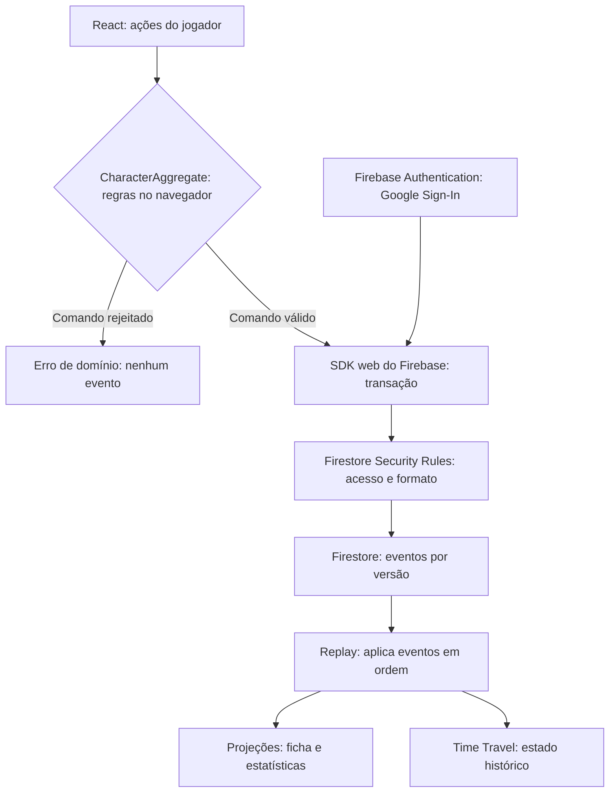

# RPG Time Machine — Workshop de Event Sourcing com Google AI Studio

> **Workshop prático:** construa um RPG com auxílio de IA, registre acontecimentos em um Event Store no Cloud Firestore, viaje no tempo reconstruindo o estado de seu herói e publique a aplicação no Cloud Run.
>
> **Público:** pessoas com noções básicas de desenvolvimento web. **Duração:** 90–120 minutos para o percurso principal; 30–45 minutos adicionais para desafios avançados. **Idioma dos prompts:** português.

## O que vamos criar

O **RPG Time Machine** é um jogo simples de personagem único. O herói começa no nível 1, treina, batalha, descansa, compra uma espada e sobe de nível. Cada ação válida gera um **evento imutável**. Em vez de guardar apenas o estado final, o aplicativo reconstrói HP, XP, ouro e equipamento reproduzindo os eventos na ordem correta.

Ao final você poderá:

- Jogar e acompanhar o histórico de eventos em uma linha do tempo;
- Voltar para qualquer ponto da história sem modificar eventos passados;
- Entrar com a conta Google e recuperar dados persistidos no Firestore;
- Entender por que comandos inválidos não devem produzir eventos;
- Publicar a aplicação diretamente pelo Google AI Studio no Cloud Run.

**Percurso principal:** etapas 1 a 5 e 8. Projeções adicionais, snapshots, idempotência e simulações de concorrência ficam nas etapas opcionais 6 e 7. Uma API própria é uma evolução posterior.

### Arquitetura do projeto



**Importante:** o Firestore é a fonte durável dos **eventos**. A ficha é uma projeção calculada no navegador por replay, sem precisar salvar o estado atual em outra coleção. O frontend usa o SDK web do Firebase; as Security Rules controlam o acesso ao banco. O percurso principal não exige API própria.

## 0. Pré-requisitos e preparação

1. Entre com uma conta Google (de preferência pessoal) em [Google AI Studio — Apps](https://aistudio.google.com/apps).
2. Use a mesma conta Google no AI Studio, no [Firebase Console](https://console.firebase.google.com/) e no [Google Cloud Console](https://console.cloud.google.com/).
3. Confira se a conta permite ativar integrações e publicar serviços; políticas de organizações podem restringir essas operações.
4. Verifique **custos, cotas e elegibilidade de tiers gratuitos** antes de criar recursos ou efetuar deploy. O Starter Tier e suas condições podem variar; um projeto padrão pode exigir faturamento habilitado.
5. Na etapa 4, use a integração do AI Studio para provisionar os recursos. Não é necessário criar manualmente um projeto ou banco antes de começar; se escolher um projeto existente, use um projeto vazio dedicado à atividade.
6. Abra este README em outra aba e mantenha **um único app no AI Studio** durante todas as etapas.

Uma segunda conta Google serve apenas para testar o isolamento dos dados; pode ser a conta de outro participante. Ela não precisa de acesso administrativo ao projeto.

**Sobre este repositório:** os prompts são o material de laboratório. O código da aplicação é **gerado no AI Studio** e não está pressuposto neste repositório. Caso queira versioná-lo, exporte o código gerado e adicione-o posteriormente em uma pasta `app/` ou em outro repositório, preservando segredos fora do Git.

### Como usar os prompts

Para cada etapa:

1. Copie **todo o texto** do bloco `Prompt`.
2. Cole no chat do **mesmo projeto** no Google AI Studio (modo **Build**).
3. Aguarde a geração/alteração e abra o **Preview**.
4. Execute o **teste de aceitação** indicado, antes de avançar.
5. Caso falhe, use o botão de correção do AI Studio ou o prompt genérico de diagnóstico ao final deste guia.

> **Conselho:** não cole todos os prompts de uma vez. Construir incrementalmente ajuda a visualizar o efeito de cada mudança arquitetural.

---

## 1. Crie o primeiro RPG — estado tradicional (10–15 min)

**Objetivo:** ter uma aplicação jogável **sem** Event Sourcing, para entender a limitação de guardar somente o estado atual.

**No AI Studio:** abra **Apps → New App**, cole o prompt e inicie a criação.

### Prompt 1 — Aplicação inicial

```text
Crie uma aplicação web funcional chamada “RPG Time Machine” para um workshop de arquitetura de software.

Use React + TypeScript, interface responsiva, tema escuro e estética de RPG de fantasia em pixel art. Use apenas estado em memória nesta primeira etapa: NÃO configure banco de dados, autenticação ou Event Sourcing ainda.

O personagem inicia com:
- nome Hero; nível 1; XP 0; HP 100; HP máximo 100;
- ouro 0; arma Wooden Sword; ataque base 5.

Ações do usuário:
- Train: ganha 25 XP;
- Battle: perde 15 HP, ganha 10 XP e 10 de ouro;
- Rest: recupera 20 HP, limitado ao HP máximo;
- Buy Sword: custa 30 de ouro, equipa Iron Sword e acrescenta +5 de ataque; a compra só pode ocorrer uma vez;
- Level Up: exige pelo menos 100 XP, consome 100 XP, aumenta nível em 1 e HP máximo em 20 (mantenha o HP atual dentro dos limites).

Regras: HP nunca negativo, ouro nunca negativo, não pode batalhar com HP 0, não pode comprar a espada sem saldo, não pode comprar duas vezes e comandos inválidos mostram feedback claro.

Layout: painel esquerdo com ficha do personagem, centro com ações, painel direito reservado para futuro histórico de eventos. Use barras de HP e XP e feedback visual nas ações.

Implemente o jogo e deixe-o funcional no Preview, não apenas um mockup.
```

**Experimente:** clique `Train`, `Battle`, `Rest`, `Buy Sword`. Recarregue a página. O que aconteceu com a memória da partida? Como descobrir quais ações produziram os atributos atuais?

**Aceite quando:** todas as ações e validações estiverem operando corretamente no Preview.

---

## 2. Converta o estado para Event Sourcing (15 min)

**Objetivo:** registrar fatos imutáveis e reconstruir o estado a partir deles.

### Prompt 2 — Event Store e replay

```text
Refatore o RPG Time Machine para usar Event Sourcing, preservando sua aparência e regras.

O histórico de eventos é a única fonte da verdade do personagem. Não atualize atributos do personagem diretamente ao executar ações.

Crie eventos imutáveis:
- CharacterCreated
- TrainingCompleted
- BattleCompleted
- CharacterRested
- SwordPurchased
- CharacterLeveledUp

Cada evento contém: id, aggregateId, version (inteiro sequencial por personagem), type, payload e timestamp. Eventos registram resultados concretos para permitir replay determinístico. O timestamp serve à auditoria; a ordenação é feita pela version.

Crie um Event Store inicialmente em memória e funções puras:
- applyEvent(state, event): CharacterState
- replayEvents(events): CharacterState

Os botões devem produzir comandos; cada comando valida regras no estado atual e gera um evento de domínio somente quando válido. Armazene esse evento, e reconstrua o estado a partir do histórico. A função applyEvent não pode usar Math.random, Date.now ou dependências externas.

No painel direito exiba a timeline de eventos em ordem de versão, com tipo, versão, horário e JSON do payload expansível. Destaque o evento mais recente.

Crie testes para replay determinístico e casos de comando inválido. Ainda não adicione Firebase nem Firestore.
```

### Exemplo ilustrativo de evento

```json
{
  "id": "evt-exemplo-002",
  "aggregateId": "hero-exemplo",
  "version": 2,
  "type": "BattleCompleted",
  "payload": {
    "damageTaken": 15,
    "xpGained": 10,
    "goldEarned": 10
  },
  "timestamp": "2026-11-22T20:00:00Z"
}
```

---

## 3. Adicione uma máquina do tempo (10 min)

**Objetivo:** enxergar um estado antigo sem apagar o futuro.

### Prompt 3 — Time Travel

```text
Adicione uma timeline interativa de Time Travel ao RPG Time Machine.

Inclua slider por versão/evento, botões Previous, Next, Play Replay e Return to Present. Ao escolher uma posição, reconstrua o estado usando APENAS os eventos até essa versão. Mostre o HP, ouro, XP, nível e arma daquele momento e compare com o estado atual.

Destaque eventos incluídos no replay e esmaeça eventos futuros. Animações sutis devem destacar quais atributos mudaram no evento atual.

Enquanto o usuário visualizar um estado histórico, desabilite os botões de gameplay. Time Travel é somente leitura: NÃO remova, reverta nem sobrescreva eventos, NÃO escreva no banco e NÃO crie ramificações de histórico.

Ao retornar ao presente, use todos os eventos para reconstruir o estado verdadeiro. Separe a lógica de replay do React para que possa ser testada.
```

**Experimente:** produza ao menos 8 eventos. Selecione o evento 3 e compare o ouro com o presente. Volte ao presente.

**Aceite quando:** mover o slider não gerar nenhum novo evento e retornar ao último evento restaurar a ficha atual.

> **Por que não fazer rollback?** Neste laboratório, “viajar no tempo” é consultar um estado histórico. Apagar eventos ou criar uma nova linha do tempo é outro problema arquitetural e não será implementado na base do workshop.

---

## 4. Configure Firebase Authentication e Firestore (15–20 min)

**Objetivo:** tornar o Event Store persistente e isolar os dados por usuário.

### Antes de colar o prompt

Peça a integração no próprio AI Studio. Quando aparecer o card **Enable Firebase / Ativar Firebase**, siga o fluxo de autorização e deixe a integração provisionar Firestore e Authentication. Se quiser escolher projeto ou região, use as configurações do card antes de confirmar. Também é possível encontrar a integração em **Settings → Integrations** (os nomes dos controles podem mudar).

A documentação oficial alerta que, ao vincular um projeto existente que já tenha Firestore, o provisionamento automático de outro banco pode não ser possível; escolha um projeto compatível ou vazio para a atividade.

### Prompt 4 — Firebase como backend

```text
Integre o RPG Time Machine ao Firebase usando a integração oficial do Google AI Studio. Preserve o gameplay e o Time Travel.

Use React/TypeScript, Firebase Authentication com Google Sign-In e Cloud Firestore. Deixe a integração provisionar e configurar os serviços. O frontend deve acessar o Firestore pelo SDK web do Firebase, protegido por Security Rules, sem criar uma API própria ou usar o SDK Admin.

No Firestore, modele:
users/{uid}/characters/{characterId} : metadados e versão atual
users/{uid}/characters/{characterId}/events/{eventId} : eventos append-only

A coleção de eventos é a fonte da verdade. Carregue os eventos por version e reconstrua a ficha com replayEvents. Calcule o estado atual no navegador, sem persistir uma projeção separada.

Ao entrar, carregue o personagem do usuário. Para um novo usuário, crie o personagem e o evento CharacterCreated juntos, em uma transação, somente se o personagem ainda não existir. Ao sair ou trocar de conta, limpe os dados locais da sessão anterior.

Para cada ação, valide as regras do jogo no estado reconstruído. Use uma transação do SDK web para criar o evento com ID único e atualizar a versão do personagem juntos. Se a versão no banco divergir da usada para validar a ação, cancele, recarregue os eventos e peça para repetir a ação; não salve um evento calculado sobre estado desatualizado. Desabilite os botões enquanto uma gravação estiver em andamento e só confirme a ação na interface após o sucesso.

Não atualize o React nem faça outros efeitos colaterais dentro da função de transação, pois ela pode ser reexecutada.

Gere e aplique Security Rules que:
- exijam login e correspondência entre request.auth.uid e o uid do caminho, inclusive nas subcoleções;
- permitam ler e criar eventos somente do próprio usuário;
- validem os campos, tipos, aggregateId, tipos de evento permitidos e version como inteiro positivo, com incremento sequencial e correspondência entre evento e personagem na transação;
- impeçam atualizar ou excluir eventos existentes e excluir o personagem pelo cliente;
- neguem acesso a caminhos não previstos.

Use a configuração web fornecida pela integração. Não gere chaves privadas nem inclua credenciais administrativas no navegador. Mostre loading e erros de login, gravação e rede. Não destrua eventos existentes. Verifique persistência após reload e isolamento entre usuários.
```

### Verificações no Firebase Console

1. Entre no app usando **Google Sign-In**.
2. Faça 3–5 ações e atualize a página: os eventos devem continuar lá.
3. Abra [Firebase Console](https://console.firebase.google.com/) → projeto → **Firestore Database** → **Data/Dados**. Examine os documentos e suas versões.
4. Examine a aba **Rules/Regras**. Pelo simulador de regras ou por testes do SDK, confira que o próprio usuário pode ler e criar eventos válidos, mas não pode atualizar/excluir eventos nem acessar dados de outro usuário. Requisições sem login e eventos malformados também devem ser negados.
5. Em **Authentication**, confira o usuário criado.
6. Se possível, teste com outra conta Google; ela **não** deve acessar o personagem da primeira.

**Aceite quando:** a partida persistir após reload, a ficha for reconstruída dos eventos e as regras de acesso, formato e imutabilidade tiverem sido verificadas.

> **Escopo didático:** as regras do jogo rodam no navegador. As Security Rules protegem acesso, formato e eventos já gravados, mas não reexecutam todo o domínio. Um cliente modificado pode tentar fabricar novos eventos próprios que passem nessas regras. Validação confiável contra trapaças fica na evolução com backend ao final do guia.

---

## 5. Formalize Commands e Aggregate (10–15 min)

**Objetivo:** separar validação de negócio do registro de eventos.

### Prompt 5 — Regras de domínio

```text
Organize a lógica de negócio do RPG usando um CharacterAggregate e Commands tipados:
TrainCharacter, BattleEnemy, RestCharacter, BuySword e LevelUpCharacter.

O agregado deve obter seu estado de eventos e implementar uma função de domínio testável:
handleCommand(state, command): DomainEvent[]

Centralize todas as regras: HP, ouro, XP, limite de cura, espada única, personagem morto e subida de nível. Comandos inválidos não produzem eventos. Registre nos eventos os resultados necessários para replay determinístico.

Mantenha o CharacterAggregate como um módulo TypeScript executado no navegador, separado dos componentes React e do acesso ao Firebase. O módulo recebe estado e comando e retorna eventos; a camada de persistência usa a transação do SDK web criada na etapa 4. Não adicione servidor, endpoints ou SDK Admin.

Mostre mensagens compreensíveis para regras violadas e falhas de gravação. Atualize a ficha e a timeline a partir dos eventos confirmados. Preserve as Security Rules existentes; a validação do jogo no navegador não substitui as regras de acesso ao banco.

Adicione um pequeno painel educativo mostrando o fluxo Command → Aggregate → Domain Event → Event Store → Projection, destacando os passos de cada ação. Preserve tudo o que já funciona.
```

**Experimente:** tente comprar a espada com menos de 30 de ouro. Confirme que surgiu um erro **sem novo evento**. Tente também comprar duas vezes.

**Aceite quando:** pela interface do jogo, comandos inválidos não gerarem eventos e a timeline refletir somente eventos confirmados no Firestore.

---

## 6. Crie projeções e snapshots (desafio avançado, 15 min)

**Objetivo:** demonstrar múltiplas leituras do mesmo histórico e uma otimização de replay.

### Prompt 6 — Read models

```text
Adicione projeções derivadas do mesmo Event Store:
1. CharacterStats: ficha atual;
2. AdventureStats: total de batalhas, treinamentos, descansos, dano recebido, ouro ganho e gasto;
3. Progression: séries de HP, XP, ouro e nível por versão.

Exiba gráficos simples para Progression e um botão Rebuild Projections que recalcule os dados usando todos os eventos em ordem de version. O processo deve ser idempotente e não alterar o Event Store.

Crie snapshots em memória a cada 10 eventos confirmados. Mantenha projeções e snapshots locais nesta extensão, sem adicionar coleções ou alterar as Security Rules do Firestore. Após reload, faça replay completo para reconstruí-los.

Cada snapshot contém aggregateId, version, state, schemaVersion e createdAt. Para reconstruir um estado, use o snapshot compatível mais recente cuja versão não ultrapasse a versão consultada e aplique somente os eventos posteriores até ela.

Exiba uma comparação didática entre replay completo e replay a partir do snapshot (quantidade de eventos processados, sem prometer ganho de desempenho).

Não remova nem modifique eventos antigos. Preserve autenticação e isolamento por usuário; descarte projeções e snapshots locais ao sair ou trocar de conta.
```

**Aceite quando:** uma reconstrução desde o início e outra usando snapshot resultarem exatamente na mesma ficha.

---

## 7. Monte o Debug Lab (desafio avançado, 15 min)

**Objetivo:** experimentar três problemas que uma arquitetura de eventos precisa enfrentar.

### Prompt 7 — Laboratório de bugs

```text
Crie uma aba educativa chamada Debug Lab com um Event Store de teste em memória, separado dos dados reais do personagem principal. Não escreva no Firestore nem crie API para essas experiências. Descarte os dados locais do laboratório ao sair ou trocar de conta.

Inclua três experiências com explicações antes e depois de executar:

A. Corrupted Projection: altere apenas uma cópia local da projeção de ouro; mostre a inconsistência e reconstrua a projeção correta a partir dos eventos.

B. Duplicated Command: implemente uma chave de idempotência no Event Store de teste e envie duas vezes o mesmo comando com a mesma chave; somente um evento deve ser criado nesse histórico local.

C. Concurrent Commands: simule duas compras sobre a mesma versão esperada no Event Store de teste; compare e atualize a versão de forma indivisível, aceitando no máximo uma compra sobre aquele estado. A outra deve receber conflito ou ser reavaliada sobre o novo estado.

Mostre os passos Command → Validation → Event → Persistence e o resultado. Inclua um botão de reset somente para a memória do laboratório. Explique que essas simulações ensinam os conceitos e não comprovam idempotência ou concorrência do app real em rede.
```

**Aceite quando:** o Event Store verdadeiro permanecer intacto, não houver gravações do laboratório no Firestore e os três experimentos locais tiverem resultado reproduzível.

---

## 8. Teste e publique no Cloud Run (10–15 min)

### Prompt 8 — Revisão antes de publicar

```text
Revise o RPG Time Machine para publicação no Cloud Run através do Publish do Google AI Studio.

Faça build e corrija erros, sem remover funcionalidades nem recriar o banco.

Confira Google Sign-In; isolamento por uid; Security Rules permitindo leitura e criação de eventos válidos do próprio usuário e negando acesso sem login, dados alheios, eventos malformados e atualização/exclusão de eventos; transação do SDK web para evento e versão; replay determinístico; ficha reconstruída após reload; Time Travel sem mutação; responsividade; loading e erros amigáveis.

Mantenha a arquitetura React + SDK web do Firebase, sem exigir API própria. As etapas opcionais 6 e 7 não são pré-requisitos para publicar. Informe a limitação da validação de gameplay no navegador, sem apresentá-la como proteção completa contra trapaças.

Não coloque segredos no navegador. Não afrouxe regras ou permissões para fazer a aplicação funcionar.

Produza um relatório curto com:
- verificações realmente executadas;
- verificações manuais pendentes;
- possíveis riscos;
- passos para publicar pelo botão Publish.

Não declare como validado o que não foi testado.
```

### Publicação no AI Studio

1. No projeto, clique em **Publish / Publicar** (canto superior direito).
2. Se aparecer, clique em **Get Started / Começar**.
3. Confirme o **projeto Google Cloud de destino** e as condições de faturamento/tier exibidas.
4. Finalize com **Publish App / Publicar app**.
5. Copie o link fornecido pelo AI Studio após a conclusão.
6. Abra o endereço em uma aba anônima ou outro navegador.
7. Faça login, execute uma ação, atualize a página e confira se o evento persistiu.
8. Caso o login falhe na URL publicada, revise a configuração de domínio autorizado no Firebase Authentication conforme as mensagens de erro e a documentação vigente.

O deploy deve ocorrer pela interface do AI Studio; **não é necessário instalar `gcloud`** no percurso principal.

**Aceite quando:** uma pessoa conseguir acessar a URL publicada, autenticar-se, jogar e consultar seu próprio histórico persistido.

---

## Checklist final

- [ ] Criei uma aplicação funcional com React e TypeScript.
- [ ] Pela interface do jogo, comandos inválidos não produzem eventos.
- [ ] Os eventos são ordenados por versão e protegidos contra atualização/exclusão pelo cliente.
- [ ] O estado pode ser reconstruído a partir do Event Store.
- [ ] O Time Travel não apaga o histórico.
- [ ] Os eventos persistem no Firestore após reload.
- [ ] Há autenticação e isolamento entre usuários.
- [ ] O frontend usa o SDK web do Firebase e confirma evento e versão na mesma transação.
- [ ] As Security Rules validam acesso e formato dos dados; compreendi o limite da validação de gameplay no navegador.
- [ ] A aplicação está publicada e funcional no Cloud Run.
- [ ] **Extra:** projeções, snapshots em memória e Debug Lab local funcionam.

## Evolução posterior — validação no servidor

Depois de concluir o percurso principal, uma aplicação que precise impedir trapaças pode mover o processamento dos comandos para uma API Node.js no Cloud Run. Nessa evolução, o servidor valida o Firebase ID Token, a propriedade do personagem e todas as regras de domínio antes de gravar; o cliente deixa de criar eventos diretamente.

Isso exige configurar a identidade de serviço e as permissões IAM de acesso ao Firestore. O SDK administrativo não aplica as Security Rules dos clientes, então a API precisa fazer sua própria autorização. Idempotência de comandos e concorrência em rede também devem ser implementadas e testadas nessa evolução. Esses requisitos não fazem parte da preparação do workshop básico.

## Quando alguma etapa falhar

Você pode usar este prompt genérico no chat do **mesmo projeto**:

```text
A última etapa não passou no teste de aceitação. Inspecione o erro real (console, network, logs, build e regras do Firebase quando disponíveis). Explique a causa raiz, proponha a menor correção e aplique-a. Preserve os eventos já existentes e as funcionalidades das etapas anteriores. Não exponha credenciais, não conceda acesso público ao Firestore e não marque testes como concluídos sem executá-los. Ao final, liste como posso verificar a correção manualmente.
```

### Problemas comuns

| Sintoma | Onde investigar |
| --- | --- |
| Login não abre no Preview | Fluxo da integração Firebase e configuração do Authentication |
| `permission-denied` | Login ativo, uid no caminho, campos enviados e Security Rules da coleção e subcoleções |
| Eventos duplicados | Registro único de handlers, cliques durante gravação e criação única de CharacterCreated; idempotência de retries é aprofundamento |
| Personagem não atualiza | Consulta de eventos por `version`, reducer e confirmação da gravação |
| Outra aba alterou o personagem | Versão usada na validação, transação do SDK web e recarga do histórico antes de repetir a ação |
| Login funciona no Preview, mas não publicado | Domínios autorizados e configuração de produção |
| Deploy pede faturamento | Tier, quotas e configuração do projeto Cloud |

## Limpeza dos recursos

Depois da atividade, confira os serviços ativos e eventuais custos no Google Cloud. Caso o app não seja mais necessário, despublique/exclua-o pelo painel do AI Studio; revise também Cloud Run, Firestore e Authentication. **Excluir apenas o app não garante que todos os recursos ou dados do projeto foram eliminados.** Exclua o projeto Cloud somente se ele for exclusivo do laboratório e não contiver recursos importantes.

## Glossário rápido

- **Command:** pedido para tentar executar uma ação (`BuySword`). Pode ser rejeitado.
- **Domain Event:** fato ocorrido (`SwordPurchased`). Depois de confirmado, não é reescrito.
- **Aggregate:** objeto lógico que concentra regras e consistência do personagem.
- **Event Store:** armazenamento durável dos eventos por agregado e versão.
- **Replay:** aplicar eventos em sequência para reconstruir estado.
- **Projection / Read Model:** visão derivada e otimizada para leitura.
- **Snapshot:** estado derivado salvo em uma versão para acelerar reconstruções futuras.
- **Idempotência:** repetir o mesmo comando lógico sem produzir efeitos duplicados.
- **Concorrência otimista:** impedir que dois comandos sejam confirmados sobre a mesma versão esperada.

## Referências

- [Codelab de inspiração: Lance seu videogame baseado na Web com IA](https://codelabs.developers.google.com/codelabs/cloud-run/launch-your-web-based-video-game-with-ai?hl=pt-br)
- [Firebase: integração com Google AI Studio](https://firebase.google.com/docs/ai-assistance/ai-studio-integration)
- [Google AI Studio — Build Mode](https://ai.google.dev/gemini-api/docs/aistudio-build-mode)
- [Firestore Security Rules](https://firebase.google.com/docs/firestore/security/get-started)
- [Condições de acesso e validação nas Security Rules](https://firebase.google.com/docs/firestore/security/rules-conditions)
- [Transações no Firestore, incluindo SDK web](https://firebase.google.com/docs/firestore/manage-data/transactions)
- [Cloud Run — Documentação](https://cloud.google.com/run/docs)

**Créditos:** roteiro original de workshop inspirado na organização e no fluxo de publicação do codelab do Google. Este material é uma adaptação independente, com exemplos e prompts próprios.
