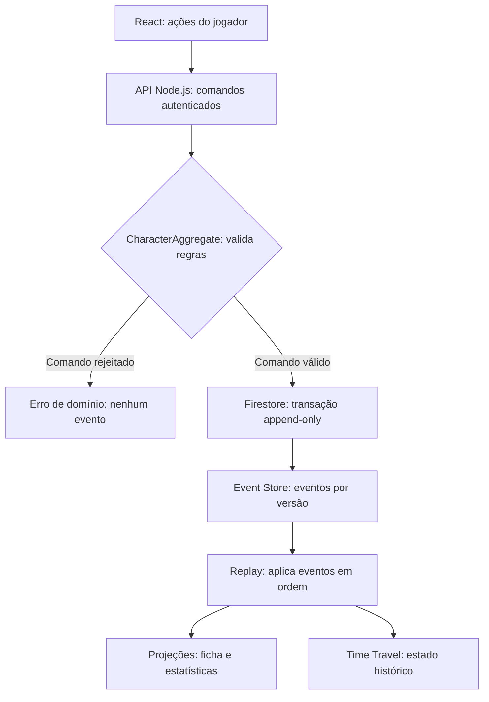

# RPG Time Machine — Workshop de Event Sourcing com Google AI Studio

> **Workshop prático:** construa um RPG com auxílio de IA, registre acontecimentos em um Event Store no Cloud Firestore, viaje no tempo reconstruindo o estado de seu herói e publique a aplicação no Cloud Run.
>
> **Público:** pessoas com noções básicas de desenvolvimento web. **Duração:** 90–120 minutos para o percurso principal; 30–45 minutos adicionais para desafios avançados. **Idioma dos prompts:** português.

## O que vamos criar

O **RPG Time Machine** é um jogo simples de personagem único. O herói começa no nível 1, treina, batalha, descansa, compra uma espada e sobe de nível. Cada ação válida gera um **evento imutável**. Em vez de guardar apenas o estado final, o aplicativo reconstrói HP, XP, ouro e equipamento reproduzindo os eventos na ordem correta.

Ao final você poderá:

- Jogar e acompanhar o histórico de eventos em uma linha do tempo;
- Voltar para qualquer ponto da história sem modificar eventos passados;
- Entrar com a conta Google e recuperar dados persistidos no Firestore;
- Investigar comandos inválidos, duplicados e concorrentes;
- Publicar a aplicação diretamente pelo Google AI Studio no Cloud Run.

### Arquitetura do projeto



**Importante:** o Firestore é a fonte durável dos **eventos**. Fichas atuais, gráficos e snapshots são **dados derivados**. A validação de comandos ocorre no servidor, não apenas na interface.

## 0. Pré-requisitos e preparação

1. Entre com uma conta Google (de preferência pessoal) em [Google AI Studio — Apps](https://aistudio.google.com/apps).
2. Tenha acesso ao [Firebase Console](https://console.firebase.google.com/) e ao [Google Cloud Console](https://console.cloud.google.com/).
3. Confira se a conta permite ativar integrações e publicar serviços; políticas de organizações podem restringir essas operações.
4. Verifique **custos, cotas e elegibilidade de tiers gratuitos** antes de criar recursos ou efetuar deploy. O Starter Tier e suas condições podem variar; um projeto padrão pode exigir faturamento habilitado.
5. Reserve um projeto Google Cloud/Firebase para a atividade. Evite usar um projeto de produção.
6. Abra este README em outra aba e mantenha **um único app no AI Studio** durante todas as etapas.

**Sobre este repositório:** os prompts são o material de laboratório. O código da aplicação é **gerado no AI Studio** e não está pressuposto neste repositório. Caso queira versioná-lo, exporte o código gerado e adicione-o posteriormente em uma pasta `app/` ou em outro repositório, preservando segredos fora do Git.

### Como usar os prompts

Para cada etapa:

1. Copie **todo o texto** do bloco `Prompt`.
2. Cole no chat do **mesmo projeto** no Google AI Studio (modo **Build**).
3. Aguarde a geração/alteração e abra o **Preview**.
4. Execute o **teste de aceitação** indicado, antes de avançar.
5. Caso falhe, use o botão de correção do AI Studio ou o prompt genérico de diagnóstico ao final deste guia.

> **Conselho:** não cole todos os prompts de uma vez. Construir incrementalmente ajuda a visualizar o efeito de cada mudança arquitetural.

---

## 1. Crie o primeiro RPG — estado tradicional (10–15 min)

**Objetivo:** ter uma aplicação jogável **sem** Event Sourcing, para entender a limitação de guardar somente o estado atual.

**No AI Studio:** abra **Apps → New App**, cole o prompt e inicie a criação.

### Prompt 1 — Aplicação inicial

```text
Crie uma aplicação web funcional chamada “RPG Time Machine” para um workshop de arquitetura de software.

Use React + TypeScript, interface responsiva, tema escuro e estética de RPG de fantasia em pixel art. Use apenas estado em memória nesta primeira etapa: NÃO configure banco de dados, autenticação ou Event Sourcing ainda.

O personagem inicia com:
- nome Hero; nível 1; XP 0; HP 100; HP máximo 100;
- ouro 0; arma Wooden Sword; ataque base 5.

Ações do usuário:
- Train: ganha 25 XP;
- Battle: perde 15 HP, ganha 10 XP e 10 de ouro;
- Rest: recupera 20 HP, limitado ao HP máximo;
- Buy Sword: custa 30 de ouro, equipa Iron Sword e acrescenta +5 de ataque; a compra só pode ocorrer uma vez;
- Level Up: exige pelo menos 100 XP, consome 100 XP, aumenta nível em 1 e HP máximo em 20 (mantenha o HP atual dentro dos limites).

Regras: HP nunca negativo, ouro nunca negativo, não pode batalhar com HP 0, não pode comprar a espada sem saldo, não pode comprar duas vezes e comandos inválidos mostram feedback claro.

Layout: painel esquerdo com ficha do personagem, centro com ações, painel direito reservado para futuro histórico de eventos. Use barras de HP e XP e feedback visual nas ações.

Implemente o jogo e deixe-o funcional no Preview, não apenas um mockup.
```

**Experimente:** clique `Train`, `Battle`, `Rest`, `Buy Sword`. Recarregue a página. O que aconteceu com a memória da partida? Como descobrir quais ações produziram os atributos atuais?

**Aceite quando:** todas as ações e validações estiverem operando corretamente no Preview.

---

## 2. Converta o estado para Event Sourcing (15 min)

**Objetivo:** registrar fatos imutáveis e reconstruir o estado a partir deles.

### Prompt 2 — Event Store e replay

```text
Refatore o RPG Time Machine para usar Event Sourcing, preservando sua aparência e regras.

O histórico de eventos é a única fonte da verdade do personagem. Não atualize atributos do personagem diretamente ao executar ações.

Crie eventos imutáveis:
- CharacterCreated
- TrainingCompleted
- BattleCompleted
- CharacterRested
- SwordPurchased
- CharacterLeveledUp

Cada evento contém: id, aggregateId, version (inteiro sequencial por personagem), type, payload e timestamp. Eventos registram resultados concretos para permitir replay determinístico. O timestamp serve à auditoria; a ordenação é feita pela version.

Crie um Event Store inicialmente em memória e funções puras:
- applyEvent(state, event): CharacterState
- replayEvents(events): CharacterState

Os botões devem produzir comandos; cada comando valida regras no estado atual e gera um evento de domínio somente quando válido. Armazene esse evento, e reconstrua o estado a partir do histórico. A função applyEvent não pode usar Math.random, Date.now ou dependências externas.

No painel direito exiba a timeline de eventos em ordem de versão, com tipo, versão, horário e JSON do payload expansível. Destaque o evento mais recente.

Crie testes para replay determinístico e casos de comando inválido. Ainda não adicione Firebase nem Firestore.
```

**O que observar:** um comando descreve uma intenção (`Battle`); um evento descreve um fato consumado (`BattleCompleted`). Se uma compra for rejeitada, **nenhum evento** deverá ser salvo.

**Aceite quando:** `replayEvents(todosOsEventos)` reproduzir exatamente os atributos exibidos e nenhuma ação inválida gerar evento.

### Exemplo ilustrativo de evento

```json
{
  "id": "evt-exemplo-002",
  "aggregateId": "hero-exemplo",
  "version": 2,
  "type": "BattleCompleted",
  "payload": {
    "damageTaken": 15,
    "xpGained": 10,
    "goldEarned": 10
  },
  "timestamp": "2026-11-22T20:00:00Z"
}
```

---

## 3. Adicione uma máquina do tempo (10 min)

**Objetivo:** enxergar um estado antigo sem apagar o futuro.

### Prompt 3 — Time Travel

```text
Adicione uma timeline interativa de Time Travel ao RPG Time Machine.

Inclua slider por versão/evento, botões Previous, Next, Play Replay e Return to Present. Ao escolher uma posição, reconstrua o estado usando APENAS os eventos até essa versão. Mostre o HP, ouro, XP, nível e arma daquele momento e compare com o estado atual.

Destaque eventos incluídos no replay e esmaeça eventos futuros. Animações sutis devem destacar quais atributos mudaram no evento atual.

Enquanto o usuário visualizar um estado histórico, desabilite os botões de gameplay. Time Travel é somente leitura: NÃO remova, reverta nem sobrescreva eventos, NÃO escreva no banco e NÃO crie ramificações de histórico.

Ao retornar ao presente, use todos os eventos para reconstruir o estado verdadeiro. Separe a lógica de replay do React para que possa ser testada.
```

**Experimente:** produza ao menos 8 eventos. Selecione o evento 3 e compare o ouro com o presente. Volte ao presente.

**Aceite quando:** mover o slider não gerar nenhum novo evento e retornar ao último evento restaurar a ficha atual.

> **Por que não fazer rollback?** Neste laboratório, “viajar no tempo” é consultar um estado histórico. Apagar eventos ou criar uma nova linha do tempo é outro problema arquitetural e não será implementado na base do workshop.

---

## 4. Configure Firebase Authentication e Firestore (15–20 min)

**Objetivo:** tornar o Event Store persistente e isolar os dados por usuário.

### Antes de colar o prompt

O Google AI Studio pode apresentar um card **Enable Firebase / Ativar Firebase** ao detectar a necessidade de autenticação e banco. Siga o fluxo de autorização e, se aplicável, selecione o projeto Google Cloud correto nas configurações da integração. Também é possível encontrar a integração em **Settings → Integrations** (os nomes dos controles podem mudar).

A documentação oficial alerta que, ao vincular um projeto existente que já tenha Firestore, o provisionamento automático de outro banco pode não ser possível; escolha um projeto compatível ou vazio para a atividade.

### Prompt 4 — Persistência segura

```text
Integre o RPG Time Machine ao Firebase Authentication (Google Sign-In) e Cloud Firestore usando a integração oficial disponível no Google AI Studio. Preserve o gameplay e o Time Travel.

Arquitetura obrigatória:
- React/TypeScript no frontend;
- backend Node.js com endpoints autenticados para listar eventos, consultar estado e executar comandos;
- validação de Firebase ID Token em cada endpoint privado;
- verificação de identidade do proprietário do personagem no servidor;
- nenhuma credencial administrativa no bundle do navegador;
- nenhuma escrita direta de eventos pelo frontend.

No Firestore, modele:
users/{uid}/characters/{characterId} : metadados e versão do agregado
users/{uid}/characters/{characterId}/events/{eventId} : eventos append-only
users/{uid}/characters/{characterId}/projections/current : estado derivado

A coleção de eventos é a fonte da verdade. Ordene eventos por version. Gere IDs únicos e use uma chave de idempotência por comando.

Cada comando deve:
1. Autenticar o usuário e resolver seu próprio personagem.
2. Ler a versão atual e dados necessários à validação.
3. Validar regras de domínio.
4. Persistir o(s) evento(s), a nova versão e a projeção em uma transação atômica do Firestore, detectando conflitos concorrentes.
5. Retornar resultado coerente para o frontend.

Não faça efeitos colaterais externos dentro de uma função de transação que pode ser reexecutada. Garanta reprocessamento seguro de comandos repetidos.

Security Rules: não permitir gravação de eventos ou projeções por clientes Firestore; leituras diretas, quando necessárias, devem ser limitadas ao próprio usuário. Todas as operações de escrita passam pelo backend autenticado. Verifique o acesso usando duas contas distintas.

Use identidades e credenciais gerenciadas pelo ambiente; não gere um JSON de chave privada nem exponha segredos. Se a integração não permitir o backend seguro exigido, identifique a limitação e peça correção; não contorne o problema liberando escrita pública.

Mostre loading, erros de autenticação e erros de rede de forma amigável. Não destrua eventos existentes. Gere testes de persistência e concorrência quando a infraestrutura permitir.
```

### Verificações no Firebase Console

1. Entre no app usando **Google Sign-In**.
2. Faça 3–5 ações e atualize a página: os eventos devem continuar lá.
3. Abra [Firebase Console](https://console.firebase.google.com/) → projeto → **Firestore Database** → **Data/Dados**. Examine os documentos e suas versões.
4. Examine a aba **Rules/Regras** e confirme que o cliente não pode alterar eventos.
5. Em **Authentication**, confira o usuário criado.
6. Se possível, teste com outra conta Google; ela **não** deve acessar o personagem da primeira.

**Aceite quando:** a partida persistir após reload e houver isolamento efetivo dos dados por usuário.

> **Cuidado:** as regras do Firestore não limitam automaticamente os privilégios de um SDK administrativo no servidor. Por isso o backend **precisa** verificar o ID Token e o dono do recurso em cada requisição.

---

## 5. Formalize Commands e Aggregate (10–15 min)

**Objetivo:** separar validação de negócio do registro de eventos.

### Prompt 5 — Regras de domínio

```text
Organize a lógica de negócio do RPG usando um CharacterAggregate e Commands tipados:
TrainCharacter, BattleEnemy, RestCharacter, BuySword e LevelUpCharacter.

O agregado deve obter seu estado de eventos e implementar uma função de domínio testável:
handleCommand(state, command): DomainEvent[]

Centralize todas as regras: HP, ouro, XP, limite de cura, espada única, personagem morto e subida de nível. Comandos inválidos não produzem eventos. Registre nos eventos os resultados necessários para replay determinístico.

No backend, processe comandos com verificação de propriedade e expectedVersion e persistência atômica no Firestore. Retorne erros compreensíveis para regras violadas e conflitos de versão. Não use validação exclusiva do frontend.

Adicione um pequeno painel educativo mostrando o fluxo Command → Aggregate → Domain Event → Event Store → Projection, destacando os passos de cada ação. Preserve tudo o que já funciona.
```

**Experimente:** tente comprar a espada com menos de 30 de ouro. Confirme que surgiu um erro **sem novo evento**. Tente também comprar duas vezes.

**Aceite quando:** a timeline refletir somente ações aceitas pelo domínio.

---

## 6. Crie projeções e snapshots (desafio avançado, 15 min)

**Objetivo:** demonstrar múltiplas leituras do mesmo histórico e uma otimização de replay.

### Prompt 6 — Read models

```text
Adicione projeções derivadas do mesmo Event Store:
1. CharacterStats: ficha atual;
2. AdventureStats: total de batalhas, treinamentos, descansos, dano recebido, ouro ganho e gasto;
3. Progression: séries de HP, XP, ouro e nível por versão.

Exiba gráficos simples para Progression e um botão Rebuild Projections que recalcule os dados usando todos os eventos em ordem de version. O processo deve ser idempotente e não alterar o Event Store.

Crie snapshots a cada 10 eventos confirmados em:
users/{uid}/characters/{characterId}/snapshots/{version}

Cada snapshot contém aggregateId, version, state, schemaVersion e createdAt. Para recuperar o estado, use o snapshot compatível mais recente e aplique somente os eventos posteriores.

Exiba uma comparação didática entre replay completo e replay a partir do snapshot (quantidade de eventos processados, sem prometer ganho de desempenho).

Não remova nem modifique eventos antigos. Preserve autenticação e isolamento por usuário.
```

**Aceite quando:** uma reconstrução desde o início e outra usando snapshot resultarem exatamente na mesma ficha.

---

## 7. Monte o Debug Lab (desafio avançado, 15 min)

**Objetivo:** experimentar três problemas que uma arquitetura de eventos precisa enfrentar.

### Prompt 7 — Laboratório de bugs

```text
Crie uma aba educativa chamada Debug Lab, isolada por usuário, sem afetar os eventos reais do personagem principal.

Inclua três experiências com explicações antes e depois de executar:

A. Corrupted Projection: altere apenas uma cópia local da projeção de ouro; mostre a inconsistência e reconstrua a projeção correta a partir dos eventos.

B. Duplicated Command: envie duas vezes o mesmo comando com a mesma chave de idempotência; somente um evento deve ser criado.

C. Concurrent Commands: simule duas compras sobre a mesma versão esperada; com transação e controle de versão, no máximo uma deve ser aceita sobre aquele estado, e a outra deve receber conflito ou reprocessamento seguro.

Mostre os passos Command → Validation → Event → Persistence e o resultado. Use dados separados do jogo principal e um botão de reset somente para dados do laboratório. Não apague o Event Store do personagem principal.
```

**Aceite quando:** o Event Store verdadeiro permanecer intacto e os três experimentos tiverem resultado reproduzível.

---

## 8. Teste e publique no Cloud Run (10–15 min)

### Prompt 8 — Revisão antes de publicar

```text
Revise o RPG Time Machine para publicação no Cloud Run através do Publish do Google AI Studio.

Faça build e corrija erros, sem remover funcionalidades nem recriar o banco.

Confira autenticação em todos os endpoints privados; propriedade dos personagens; Firestore seguro; escrita append-only no backend; idempotência; controle de versão; replay determinístico; recuperação após reload; Time Travel sem mutação; responsividade; loading e erros amigáveis.

Não coloque segredos no navegador. Não afrouxe regras ou permissões para fazer a aplicação funcionar.

Produza um relatório curto com:
- verificações realmente executadas;
- verificações manuais pendentes;
- possíveis riscos;
- passos para publicar pelo botão Publish.

Não declare como validado o que não foi testado.
```

### Publicação no AI Studio

1. No projeto, clique em **Publish / Publicar** (canto superior direito).
2. Se aparecer, clique em **Get Started / Começar**.
3. Confirme o **projeto Google Cloud de destino** e as condições de faturamento/tier exibidas.
4. Finalize com **Publish App / Publicar app**.
5. Copie o link fornecido pelo AI Studio após a conclusão.
6. Abra o endereço em uma aba anônima ou outro navegador.
7. Faça login, execute uma ação, atualize a página e confira se o evento persistiu.
8. Caso o login falhe na URL publicada, revise a configuração de domínio autorizado no Firebase Authentication conforme as mensagens de erro e a documentação vigente.

O deploy deve ocorrer pela interface do AI Studio; **não é necessário instalar `gcloud`** no percurso principal.

**Aceite quando:** uma pessoa conseguir acessar a URL publicada, autenticar-se, jogar e consultar seu próprio histórico persistido.

---

## Checklist final

- [ ] Criei uma aplicação funcional com React e TypeScript.
- [ ] Os comandos produzem eventos apenas quando válidos.
- [ ] Os eventos são imutáveis e ordenados por versão.
- [ ] O estado pode ser reconstruído a partir do Event Store.
- [ ] O Time Travel não apaga o histórico.
- [ ] Os eventos persistem no Firestore após reload.
- [ ] Há autenticação e isolamento entre usuários.
- [ ] O backend valida comandos e protege as gravações.
- [ ] A aplicação está publicada e funcional no Cloud Run.
- [ ] **Extra:** projeções, snapshots e Debug Lab funcionam.

## Quando alguma etapa falhar

Você pode usar este prompt genérico no chat do **mesmo projeto**:

```text
A última etapa não passou no teste de aceitação. Inspecione o erro real (console, network, logs, build e regras do Firebase quando disponíveis). Explique a causa raiz, proponha a menor correção e aplique-a. Preserve os eventos já existentes e as funcionalidades das etapas anteriores. Não exponha credenciais, não conceda acesso público ao Firestore e não marque testes como concluídos sem executá-los. Ao final, liste como posso verificar a correção manualmente.
```

### Problemas comuns

| Sintoma | Onde investigar |
| --- | --- |
| Login não abre no Preview | Fluxo da integração Firebase e configuração do Authentication |
| `permission-denied` | Firestore Rules, caminho consultado, ID Token e propriedade do recurso |
| Eventos duplicados | Idempotency key, retries, transação e versões |
| Personagem não atualiza | Ordenação por `version`, reducer e leitura da projeção |
| Duas compras aceitas simultaneamente | Controle otimista e transação atômica no backend |
| Login funciona no Preview, mas não publicado | Domínios autorizados e configuração de produção |
| Deploy pede faturamento | Tier, quotas e configuração do projeto Cloud |

## Limpeza dos recursos

Depois da atividade, confira os serviços ativos e eventuais custos no Google Cloud. Caso o app não seja mais necessário, despublique/exclua-o pelo painel do AI Studio; revise também Cloud Run, Firestore e Authentication. **Excluir apenas o app não garante que todos os recursos ou dados do projeto foram eliminados.** Exclua o projeto Cloud somente se ele for exclusivo do laboratório e não contiver recursos importantes.

## Glossário rápido

- **Command:** pedido para tentar executar uma ação (`BuySword`). Pode ser rejeitado.
- **Domain Event:** fato ocorrido (`SwordPurchased`). Depois de confirmado, não é reescrito.
- **Aggregate:** objeto lógico que concentra regras e consistência do personagem.
- **Event Store:** armazenamento durável dos eventos por agregado e versão.
- **Replay:** aplicar eventos em sequência para reconstruir estado.
- **Projection / Read Model:** visão derivada e otimizada para leitura.
- **Snapshot:** estado derivado salvo em uma versão para acelerar reconstruções futuras.
- **Idempotência:** repetir o mesmo comando lógico sem produzir efeitos duplicados.
- **Concorrência otimista:** impedir que dois comandos sejam confirmados sobre a mesma versão esperada.

## Referências

- [Codelab de inspiração: Lance seu videogame baseado na Web com IA](https://codelabs.developers.google.com/codelabs/cloud-run/launch-your-web-based-video-game-with-ai?hl=pt-br)
- [Firebase: integração com Google AI Studio](https://firebase.google.com/docs/ai-assistance/ai-studio-integration)
- [Google AI Studio — Build Mode](https://ai.google.dev/gemini-api/docs/aistudio-build-mode)
- [Firestore Security Rules](https://firebase.google.com/docs/firestore/security/get-started)
- [Cloud Run — Documentação](https://cloud.google.com/run/docs)

**Créditos:** roteiro original de workshop inspirado na organização e no fluxo de publicação do codelab do Google. Este material é uma adaptação independente, com exemplos e prompts próprios.
